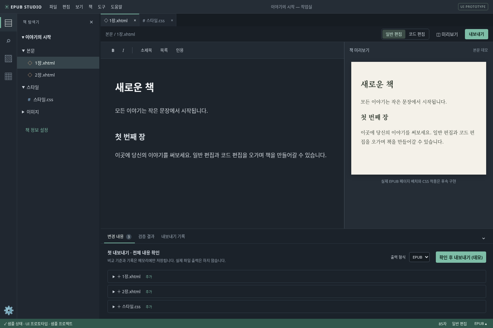

# UI 프로토타입

브랜치: `feature/ui-prototype`. 실제 저장·가져오기·내보내기 기능을 개발하기 전에 화면 구조와 작업 흐름을 확인하는 단계입니다.



## 실행

```sh
npm ci
npm run dev:web
```

Windows에서는 `npm run dev`로 Electron 앱을 실행합니다. Electron에서는 네이티브 메뉴바를 사용하며, 브라우저에서는 같은 명령의 대체 메뉴를 표시합니다. 이 Linux 환경에서는 Electron 데스크톱 실행이 제한되어 브라우저 UI만 검증합니다.

## 확인 가능한 동작

- 어두운 코드 에디터 형태의 활동 바·사이드바·파일 탭·편집기·하단 패널·상태바.
- 책 탐색기에서 장과 CSS를 열고 탭을 닫거나 다시 열기. 편집 내용은 세션 메모리에 유지.
- Tiptap 일반 편집, Monaco HTML/CSS 코드 편집, 기본 문서 요소의 모드 전환.
- 정리한 HTML을 보여주는 미리보기 분할 화면. 실제 EPUB 페이지 배치와 사용자 CSS 적용은 미구현.
- 샘플 문서 전체 검색과 검색 결과의 파일 열기.
- 사이드바 및 하단 패널 접기·펼치기, 드래그 또는 방향키 크기 조절. 크기는 localStorage에 기억.
- 하단 탭 전환: 변경 내용, 검증 결과, 내보내기 기록. 선택한 탭을 다시 누르면 접힘.
- EPUB/PDF별 기준본과 텍스트 변경 확인 데모. 출력 데모 성공 후 해당 형식의 메모리 기준본 갱신.
- 새 책·템플릿 선택, 최근 프로젝트·DOCX 가져오기 안내, 책 설정 대화상자.
- Ctrl+B 사이드바, Ctrl+J 하단 패널, Ctrl+S 저장 데모. 대화상자는 Escape로 닫기.

## 실제 기능과 구분

책과 편집 내용, 메타데이터, 비교 기준본, 출력 기록은 메모리에만 있습니다. 페이지를 새로 고치거나 앱을 재시작하면 샘플 상태로 돌아갑니다. 저장 버튼은 메모리의 미저장 표시만 갱신하고, 출력 버튼은 흐름과 기록을 보여줍니다. PC에 프로젝트나 EPUB/PDF 파일을 생성하지 않습니다.

DOCX와 미디어 파일을 읽지 않으며 EPUBCheck도 실행하지 않습니다. 검증 안내는 샘플입니다. 템플릿은 시작 문서 예시이며 완성된 책 디자인이 아닙니다. 임의 XHTML을 일반 편집으로 전환하면 지원하지 않는 태그가 유실될 수 있습니다.

## 검토 포인트

1. 탐색기·편집기·미리보기의 배치와 기본 크기가 적절한가?
2. 일반/코드 전환과 파일 탭이 이해하기 쉬운가?
3. 하단 패널의 탭 전환·접기 동작이 기대와 맞는가?
4. 변경 확인과 출력 형식 선택을 하단에서 진행하기 편한가?
5. 저장과 실제 파일 출력의 차이가 명확한가?

UI 검토·확정 이후 기능 Task를 단계별로 진행합니다. 이 프로토타입을 프로젝트 저장이나 EPUB 출력 Task의 완료로 간주하지 않습니다.
